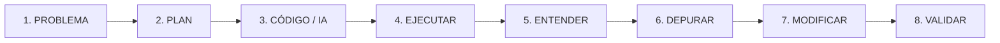

# 01 · GUÍA GENERAL DEL CURSO: PROGRAMAR EN 2027

## 1. Visión Global del Itinerario

El curso **"Programar en 2027"** es un programa formativo modular desarrollado para la **Red de Centros Circular FAB**: un curso en castellano para aprender a programar con Python como lenguaje principal, avanzando desde fundamentos y proyectos reales hasta debugging, validación, Git, trabajo con IA y agentes bajo revisión humana. Principio: la IA puede ayudar, proponer y modificar; la persona entiende, revisa, prueba y decide.

Su propósito es capacitar a ciudadanos, emprendedores, técnicos y profesionales en el uso de Python como herramienta de computación moderna, automatización, análisis de datos y desarrollo de software asistido por Inteligencia Artificial generativa.

### Orden vigente para empezar

1. **Prepara el equipo:** [preparacion.html](../preparacion.html) reúne la guía y los paquetes para [Windows](../assets/descargas/preparar-python-windows-2027.zip), [Ubuntu](../assets/descargas/Programar_2027_Instalacion_Ubuntu.zip) y [macOS](../assets/descargas/Programar_2027_Instalacion_macOS.zip). Orienta la preparación de GitHub, VS Code, Python y las herramientas necesarias según sistema y práctica. El profesor particular acompaña y comprueba con el alumno; el pack documental no instala programas.
2. **Elige ruta:** [inicio.html#rutas](../inicio.html#rutas) ofrece la **Ruta A**, proyectos con agentes desde la [Experiencia 1](../lab-python-en-accion/recursos/experiencias/07-agentes-programacion.html), y la **Ruta B**, fundamentos de Python desde [Bloque 1](../bloques/bloque1/inicio.html). En la Ruta A se puede empezar con la práctica sin estudiar antes los bloques.
3. **Continúa según evidencias:** pregunta qué actividad ha completado, qué funciona y qué duda queda. Usa los siete bloques de esta guía o las [17 experiencias del recorrido](08-LAB-PYTHON-EN-ACCION.md), respetando los requisitos de cada página. El profesor particular puede acompañar también un [proyecto propio](09-PROYECTOS-PROPIOS.md).

### Objetivos Generales
1. **Desmitificar la programación:** Transformar la barrera técnica inicial en una habilidad práctica accesible mediante entornos interactivos inmediatos (Google Colab / Jupyter Notebooks).
2. **Dominar las estructuras esenciales del lenguaje:** Comprender la lógica algorítmica, las colecciones de datos, el paradigma funcional/modular y los fundamentos de la Programación Orientada a Objetos (POO).
3. **Manejar datos y automatización:** Usar NumPy, Pandas y ReportLab en el Proyecto aplicado 3 a partir de CSV local; conocer Playwright en los materiales de automatización de B5.
4. **Dar el salto al entorno profesional:** Migrar con soltura del cuaderno interactivo a proyectos locales estructurados en Visual Studio Code, con entornos virtuales (`venv`), gestión de paquetes (`pip`) y control de versiones básico (`Git`).
5. **Gobernar el desarrollo asistido por IA (2027):** Integrar asistentes y modelos de lenguaje como copilotos de programación bajo un protocolo estricto de auditoría y validación crítica, erradicando el "desarrollo zombi".

---

## 2. Metodología Pedagógica: "Aprender Haciendo"

El curso destierra las clases magistrales extensas y adopta un enfoque de **aprendizaje activo basado en retos iterativos**:

```
[Explicación breve (3-5 min)] ➔ [Ejemplo mínimo ejecutable] ➔ [Ejecución en vivo] ➔ [Modificación guiada] ➔ [Predicción de salida] ➔ [Mini-Reto individual] ➔ [Comprobación]
```

### El Flujo Crítico de Trabajo 2027 (Asistido por IA)
En la era actual, programar no consiste en memorizar sintaxis, sino en orquestar soluciones y validar código:



1. **Problema:** Definir claramente qué se quiere resolver en lenguaje natural y reglas de negocio.
2. **Plan:** Diseñar la arquitectura lógica (entradas, pasos de procesamiento, estructuras de datos y salidas).
3. **Código / IA:** Redactar el código manualmente o solicitarlo a la IA mediante un prompt estructurado y acotado.
4. **Ejecutar:** Correr el script en el entorno real (consola / Colab / VS Code).
5. **Entender:** Analizar qué hace cada línea antes de aceptarla.
6. **Depurar:** Leer el *Traceback*, localizar excepciones o errores de lógica.
7. **Modificar:** Ajustar el código para satisfacer requerimientos específicos o casos de borde.
8. **Validar:** Ejecutar baterías de pruebas con datos extremos y verificar la ausencia de efectos secundarios.

### Metodología "Anti-Zombi"
Se denomina **programador zombi** a quien copia y pega fragmentos de código autogenerados por IA sin comprender su funcionamiento, sin saber depurarlos cuando fallan y sin poder justificar sus decisiones de diseño. El curso fomenta la **explicación oral, predicción de salidas y lectura crítica de trazas de error**.

### Acompañamiento y autonomía

La ayuda disminuye de forma progresiva: el docente o el profesor particular modela, acompaña una primera ejecución, ofrece pistas graduadas y retira apoyo hasta que el alumno puede formular una hipótesis, modificar, probar y explicar su decisión. El enfoque transversal **«Rompe y repara»** parte de un estado sano y recuperable, provoca un fallo controlado, localiza su causa y repite pruebas después de repararlo. Conserva los títulos de las actividades, como **Rompe, entiende y depura** en B6.

---

## 3. Mapa Curricular del Curso (B1 a B7)

La Ruta B empieza en el [Bloque 1](../bloques/bloque1/inicio.html). B1-B5 ofrecen cuadernos prácticos y B3-B5 copias de proyectos; B6 y B7 se organizan en seis experiencias cada uno. El [mapa de recursos de 04](04-PRACTICAS-Y-APOYOS.md) enlaza esas entradas. Las duraciones de 150/90/60/30 minutos de las guías son adaptaciones, no sustituyen las duraciones de cada página.

El siguiente esquema resume la progresión confirmada hasta B6. En B7 conviven una ruta pública de seis experiencias y un material opcional de evidencia y defensa; no se exige una base final nueva.

```
[B1: Fundamentos y Lógica]
        │
        ▼
[B2: Estructuras de Datos] ──► [Proyecto B2: Clasificador e Indexador de Palabras]
        │
        ▼
[B3: Funciones y Modularidad] ──► [Proyecto aplicado 1 (Persistencia JSON/CSV)]
        │
        ▼
[B4: Programación Orientada a Objetos] ──► [Proyecto aplicado 2 (Clases y Herencia)]
        │
        ▼
[B5: Python Aplicado y Librerías] ──► [Proyecto aplicado 3 (CSV, NumPy, Pandas, PDF)]
        │
        ▼
[B6: Herramientas para trabajar con tus proyectos] ──► [Base de trabajo B6 (VS Code, venv, Git, depuración)]
        │
        ▼
[B7: Trabajo como developer con agentes]
        ├─► [Ruta publicada: arnés, repositorio, grafo opcional e IA bajo control]
        └─► [Material opcional: evidencia, validación y defensa]
```

---

## 4. Tabla Sinóptica de los 7 Bloques

| Bloque | Título y Enfoque | Entorno | Conceptos Centrales | Proyecto / Hito |
| :--- | :--- | :--- | :--- | :--- |
| **B1** | **Fundamentos y Lógica**<br>Primeros programas en notebook | Google Colab / Notebook | `print()`, variables, tipos (`str`, `int`, `float`, `bool`), `divmod()`, casting, `input()`, f-strings, `if/elif/else`, bucles `for`/`while`, `range()`, `break`, `continue`. | Prácticas 01 a 04: operaciones, tramos de precios, cálculo de medias y bucles interactivos. |
| **B2** | **Estructuras de Datos**<br>Colecciones y manipulación | Google Colab / Notebook | Cadenas (slicing bidireccional y reversión), listas y mutabilidad, tuplas (inmutabilidad), sets (unicidad y teoría de conjuntos), diccionarios (claves y `.get()`), comprehensions. | **Clasificador e Indexador de Palabras Clave** (análisis de texto y conteo estructurado). |
| **B3** | **Funciones y Modularidad**<br>Programas reutilizables | Colab / Scripts `.py` | `def`, `return` frente a `print()`, parámetros opcionales por defecto, scope local vs global, docstrings, `try-except-else-finally`, `with open()`, JSON nativo, CSV, `import`. | **Proyecto aplicado 1**: calcula y guarda precios desde consola. |
| **B4** | **POO (Orientada a Objetos)**<br>Modelado robusto | Colab / VS Code | Clases vs instancias, `__init__`, `self`, métodos de instancia, atributos públicos y privados (convención `_`), composición ("tiene un"), herencia ("es un"), `super()`, polimorfismo. | **Proyecto aplicado 2**: organiza productos con clases. |
| **B5** | **Python Aplicado y Librerías**<br>Ecosistema de datos | Colab / VS Code | NumPy (arrays `ndarray`, operaciones vectorizadas, estadísticas), Pandas (Series, DataFrames, filtros booleanos, dataset GoT `got_1.csv` como práctica didáctica), Playwright (automatización web), ReportLab Platypus (generación real de PDF). | **Proyecto aplicado 3**: CSV de hardware → Pandas/NumPy → ReportLab. Playwright queda fuera del flujo de este proyecto. |
| **B6** | **Herramientas para trabajar con tus proyectos**<br>Desarrollo local | VS Code Local | Seis experiencias: orientación, entorno y dependencias, flujo, depuración, cambio acotado y Git local. | **Base de trabajo B6**: copia personal con un cambio funcional comprobado y un commit local explicado; no exige `push`. |
| **B7** | **Trabajo como developer con agentes**<br>Desarrollo asistido y validación | VS Code + agente | Seis experiencias: arnés, repositorio de participantes, depuración, refactor y diff, grafo sin LLM e IA bajo control con Ollama opcional. | Cuatro proyectos de práctica publicados. El cierre heredado queda fuera del recorrido; LangGraph se presenta como ampliación separada. |

---

## 5. La progresión de proyectos aplicados

Los proyectos aplicados de B3 a B5 desarrollan una misma familia de problemas de forma progresiva, sin exigir que se reutilicen automáticamente archivos entre bloques.

1. **B3 · Proyecto aplicado 1:** funciones y módulos para calcular precios, evaluar alertas y registrar transacciones en CSV, con configuración JSON y log.
2. **B4 · Proyecto aplicado 2:** productos, hardware y licencias; composición en AuditoriaMercado y persistencia en ManejadorDatos.
3. **B5 · Proyecto aplicado 3:** CSV local de hardware, análisis con Pandas/NumPy y PDF con ReportLab Platypus.
4. **B6 · Herramientas para trabajar con tus proyectos:** copia personal para orientarse, preparar entorno, depurar, modificar y guardar un cambio con Git.
5. **B7 · material opcional de evidencia y defensa:** se aplica sobre un proyecto ya ejecutado. La portada de B7 publica además seis experiencias con proyectos propios; no se añade una base final nueva.

Consulta [06 · Contexto de proyectos](06-CONTEXTO-PROYECTOS.md) solo para antecedentes técnicos. No atribuyas a una copia los archivos, las clases ni los resultados de otra.

## 6. Lab · Laboratorio de programación: recorrido y laboratorios

[Recorrido práctico · Construye y conecta tus proyectos](../lab-python-en-accion/index.html) es la Ruta A, independiente de los bloques; permite empezar con su primera experiencia sin cursarlos antes.

El portal contiene un recorrido desde agentes y API hasta datos persistentes, interfaces, contexto conectado e IA controlada, además de laboratorios como OpenCV, Pillow, archivos, Excel, Tkinter y RAG local. Consulta [08 · Mapa y apoyos](08-LAB-PYTHON-EN-ACCION.md) y los prerrequisitos de cada experiencia.

Las cinco fichas originales siguen siendo útiles; ya no representan todo el recurso. No deduzcas el catálogo a partir de un subtítulo numérico antiguo.

---

## 7. Contexto de Aplicación en la Red Circular FAB

Los talleres de la Red Circular FAB se caracterizan por una gran diversidad de perfiles de alumnado (desde personas sin experiencia previa hasta perfiles técnicos que buscan actualizarse). 

Por ello, el formador debe:
* **Fomentar la autonomía:** Que los alumnos lean los errores de consola antes de pedir ayuda inmediata.
* **Contextualizar los ejercicios:** Relacionar los problemas con la gestión de talleres, control de inventarios, sensores de fabricación digital, monitorización de recursos y análisis de datos locales.
* **Ajustar el ritmo con flexibilidad:** Utilizar las adaptaciones temporales (150 min estándar, 90 min intensivo, 60 min compacto o 30 min cápsula) según la convocatoria.
